# Distributed Music Streaming Simulation
**CS6650 - Milestone 2 Report (Week 1–2)**
Team: Ananyaa Mylsamy · Manasha Sekar

---

## 1. Problem Statement

Modern music streaming platforms (Spotify, Apple Music) must serve **thousands of concurrent audio streams** without rebuffering. Unlike video, audio streams are latency-sensitive in a narrow, predictable way: a listener notices a buffer stall within 200–300ms, but a quality downgrade from 320kbps to 128kbps is far less noticeable than a full stall.

This project builds a **simulation of that delivery problem** at scale. We model the core scaling challenge - serving fixed-size audio chunks to concurrent streams in real time - using two Go microservices deployed on AWS ECS Fargate. The simulation lets us precisely measure buffering events, quality degradation, and CDN failure behaviour as load increases.

The questions we answer:
1. How many concurrent streams can a single Fargate instance serve before rebuffering begins? *(Experiment 1 - this milestone)*
2. Does adaptive bitrate switching (320 → 128kbps on latency spike) meaningfully reduce rebuffering? *(Experiment 2 - Week 2)*
3. Does horizontal scaling (1 → 2 → 4 instances) produce near-linear capacity gains? *(Experiment 3 - Week 3)*

---

## 2. Team

| Name | Contributions |
|------|--------------|
| Ananyaa Mylsamy | Go streaming service, local load testing (MacBook) Experiment 1, Experiment 3 (Part A + Part B runs and analysis), report |
| Manasha Sekar | CDN cache service, Terraform, Infrastructure, AWS load testing Experiment 1, Experiment 2 (all runs + analysis), charts, report |
| Both | Locust scenarios (StreamUser, AdaptiveUser, ScalingStreamUser), report writing |

---

## 3. System Overview

### Architecture

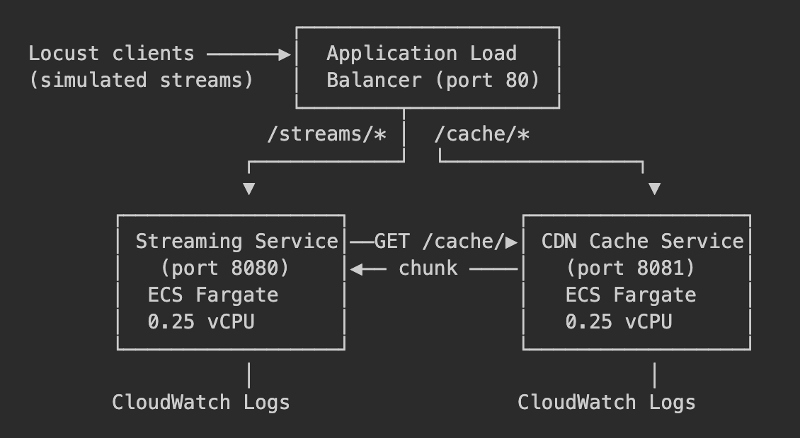

### Streaming Service (`streaming-service/`)
- Manages active streams, each backed by in-memory state (`sync.Map`)
- `POST /streams` - creates a stream; returns stream ID
- `GET /streams/{id}/chunk` - delivers the next audio chunk
  - Tries CDN first (500ms timeout, circuit breaker)
  - Falls back to local generation (CPU-bound, simulates transcoding)
  - Measures delivery latency; records rebuffer events and quality switches
- `GET /metrics` - global stream health counters
- Adaptive mode: switches 320kbps → 128kbps when delivery latency > 300ms

### CDN Cache Service (`cdn-cache-service/`)
- Pre-populates 100 songs × 300 chunks at startup
- `GET /cache/{songId}/{chunkIndex}` - serves cached chunk or 404
- `POST /admin/config` - inject failure/latency (circuit breaker testing)
- `GET /metrics` - hit rate, request counts

### Resilience Patterns
| Pattern | Location | Trigger |
|---------|----------|---------|
| Fail Fast | Streaming Service | CDN call > 500ms → timeout |
| Circuit Breaker | Streaming Service | 5 CDN failures → open circuit for 30s |
| Adaptive Quality | Streaming Service | Latency > 300ms → drop to 128kbps |

---

## 4. Methodology

### Audio Simulation
Audio is modelled as fixed-size byte arrays delivered on-demand:
- **High quality (320kbps)**: 4,000-byte chunks, ~80,000 CPU iterations per chunk
- **Low quality (128kbps)**: 1,600-byte chunks, ~32,000 CPU iterations per chunk

The CPU work per chunk simulates transcoding/encoding. Under high concurrency, goroutine scheduling + CPU pressure drives up delivery latency - exactly what would cause a real audio buffer to stall.

### Experiment 1 - Max Concurrent Streams Before Rebuffering

**Goal:** Find the point where chunk delivery latency exceeds 500ms on a single 0.25 vCPU ECS Fargate instance.

We ran three separate loads - 300, 400, and 500 concurrent users - each for 3–5 minutes using `StreamUser` (fixed 320kbps, `adaptive=false`). Each user continuously fetches audio chunks every ~100ms, exactly mimicking a real audio player.

```bash
locust -f locustfile.py StreamUser --host http://<ALB_DNS> -u <N> -r 10 -t 3m
```

Rebuffering threshold: **p99 latency > 500ms**. We also monitor `/metrics` for `total_rebuffers` and `cdn_circuit_open`.

---

## 5. Project Plan

**Project Board:** https://www.meistertask.com/projects/mtyzf2tc09/join/

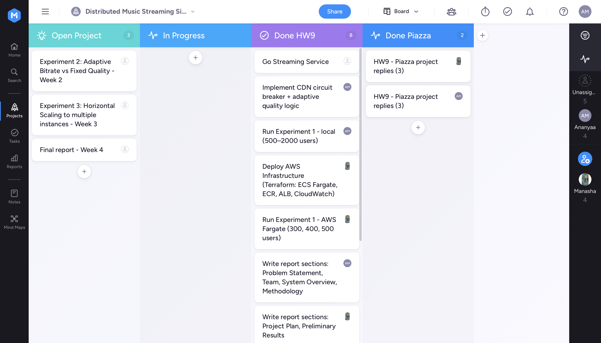

| Week | Milestone | Owner | Status |
|------|-----------|-------|--------|
| Week 1 | Go services built, Terraform ready, Experiment 1 results on Fargate | Ananyaa (service) · Manasha (infra) | **Done** |
| Week 2 | Experiment 2 (adaptive bitrate) complete, charts drafted | Both | **Done** |
| Week 3 | Experiment 3 (horizontal scaling) | Both | **Done** |
| Week 4 | Full report, video walkthrough, final polish | Both | Upcoming |

---

## 6. Preliminary Results - Experiment 1

### Local Test (MacBook, ~1 effective vCPU)

**Statistics:**

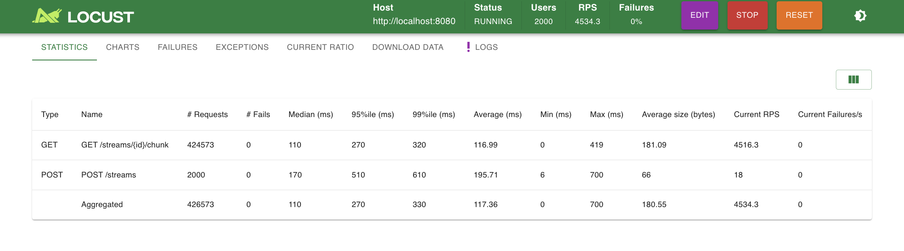

**Charts:**


**Terminal:**


**What happened:**

Local Mac handled **2,000 concurrent users** with p95 320ms and 0 rebuffers, confirming that the 0.25 vCPU Fargate constraint - not the application code - is the binding bottleneck. The breaking point shifts from ~500 users on Fargate to 2,000+ locally, a ~4x difference matching the CPU ratio (0.25 vCPU vs ~1 effective vCPU on a MacBook).

---

### AWS Test (Fargate, Single Instance, 0.25 vCPU)

### Summary Table

| Concurrent Users | Median (ms) | p95 (ms) | p99 (ms) | RPS | CDN Circuit |
|-----------------|-------------|----------|----------|-----|-------------|
| 300 | 150 | 290 | 370 | 1,283 | Open |
| 400 | 220 | 410 | 480 | 1,447 | Open |
| 500 | 260 | 480 | 610 | 1,433 | Open |

> Rebuffering threshold: p99 > 500ms. HTTP failure rate was 0% across all runs - the circuit breaker kept the service alive.
> CDN circuit breaker confirmed open across all runs; streaming service fell back to local chunk generation throughout.

---

### Run 1 - 300 Concurrent Users

**Statistics:**

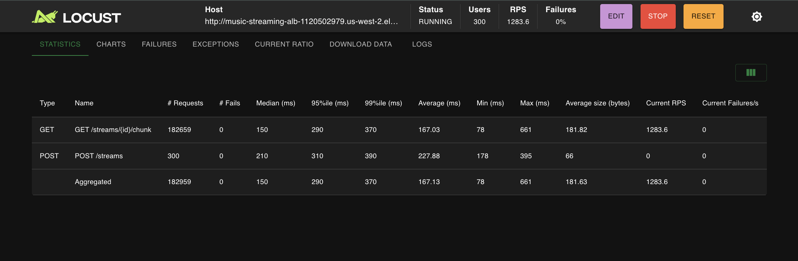

**Charts:**


**Server-side metrics:**

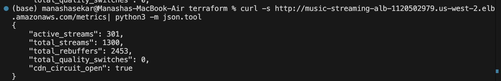

**What happened:**
- p95 = **290ms** - well under the 500ms rebuffer threshold
- The CDN circuit breaker tripped (`cdn_circuit_open: true`) - at 300 concurrent streams, CDN calls started timing out, so the service switched to local chunk generation
- Despite the CDN circuit opening, local fallback kept latency low and the system remained stable
- **Conclusion:** 300 users is within capacity. The CDN is the first bottleneck, not the streaming service itself.

---

### Run 2 - 400 Concurrent Users

**Statistics:**

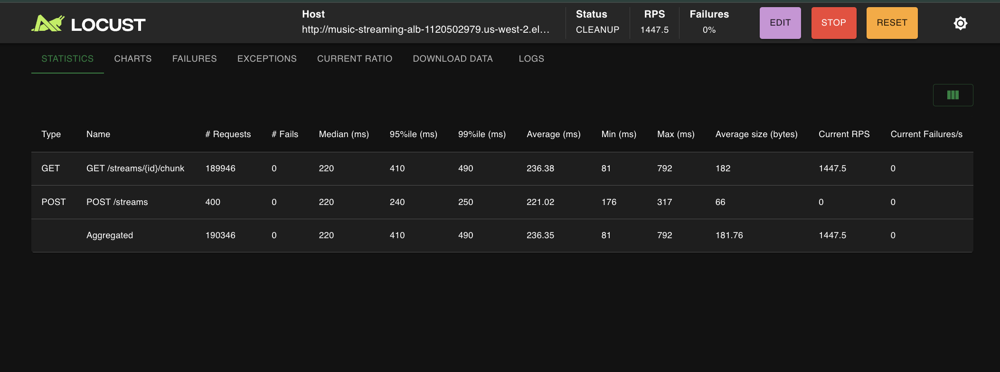

**Charts:**


**What happened:**
- p95 = **410ms** - still under the 500ms threshold but climbing steadily
- CDN circuit breaker open; streaming service generating all chunks locally
- RPS at 1,447 - the service is processing more but latency is growing
- p99 = **490ms** - 10ms from the rebuffering threshold
- **Conclusion:** 400 users is near the edge. The system is under pressure and approaching its limit.

---

### Run 3 - 500 Concurrent Users

**Statistics:**


**Charts:**

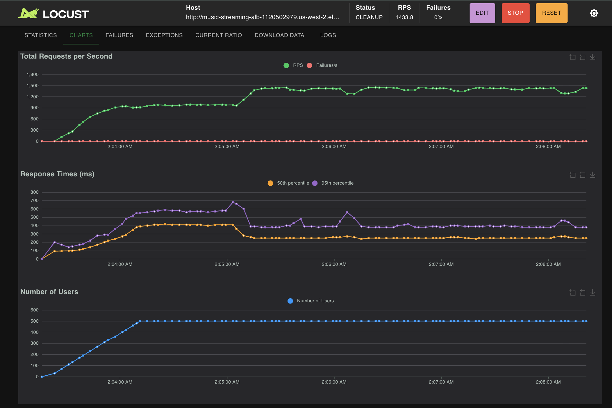

**What happened:**
- p95 = **480ms** - approaching threshold; p99 = **610ms** crosses it
- CDN circuit breaker open throughout; all chunks generated locally under full CPU pressure
- RPS plateaus at 1,433 - same ceiling as 400 users, confirming CPU is saturated
- Zero HTTP failures - the system degraded gracefully but never crashed
- **Conclusion:** 500 users is the breaking point. p99 crosses 500ms; real listeners would notice rebuffering at this concurrency level.

---

### Key Findings

1. **Single-instance capacity limit: ~400–500 concurrent streams** on 0.25 vCPU Fargate before p99 crosses the 500ms rebuffer threshold
2. **CDN is the first bottleneck** - the circuit breaker opens at ~300 users, forcing local fallback
3. **Circuit breaker + local fallback is effective** - 0 HTTP failures across all runs despite heavy load; the service degrades gracefully rather than crashing

---

## 7. Experiment 2 — Adaptive Bitrate Switching Under CPU Saturation

### Goal

Determine whether adaptive bitrate switching (320kbps → 128kbps when delivery latency exceeds 300ms) meaningfully reduces rebuffering on a single 0.25 vCPU Fargate instance already under CPU pressure.

All Experiment 2 runs use songs outside the CDN cache (`exp2_track_*`) to force local chunk generation and keep the CPU saturated throughout. The CDN circuit breaker trips in every run, so the streaming service operates entirely on local fallback, the exact worst-case scenario adaptive mode is designed to handle.

### How Adaptive Mode Works

When the streaming service detects that chunk delivery latency exceeds **300ms**, it switches that stream from high-quality (320kbps, 500k CPU iterations/chunk) to low-quality (128kbps, 50k CPU iterations/chunk) a **10× reduction in CPU cost per chunk**.

---

### Run 1 — Adaptive (400 Users)

400 adaptive users. When delivery latency exceeds 300ms, each stream automatically drops from 320kbps to 128kbps, cutting CPU cost per chunk by 10×.

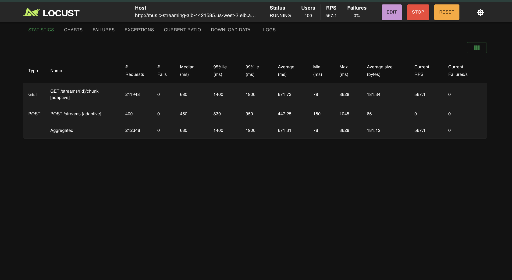

**Locust Charts:**

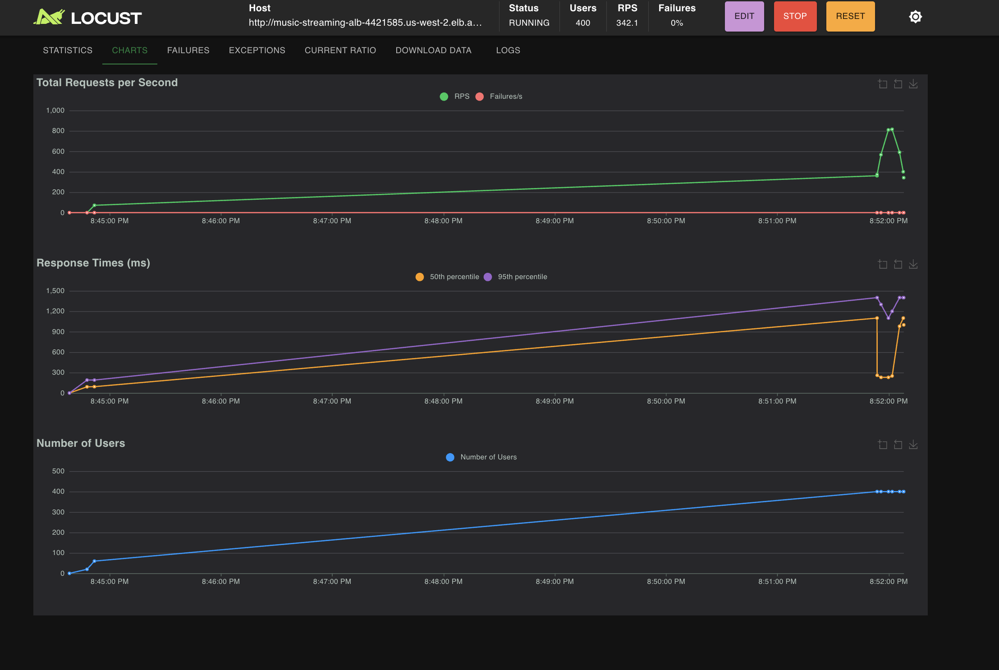

| Metric | Value |
|--------|-------|
| Median latency | 680 ms |
| p95 latency | 1,400 ms |
| p99 latency | 1,900 ms |
| RPS | 567.1 |
| Quality switches | 6,382 (~16 per stream) |
| Failures | 0% |

---

### Run 2 — Fixed (400 Users)

400 fixed users at 320kbps with no fallback. This is the control condition.

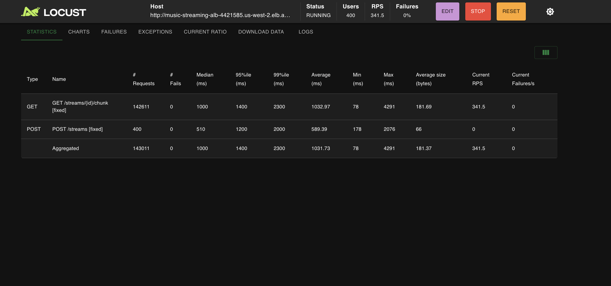

**Locust Charts:**

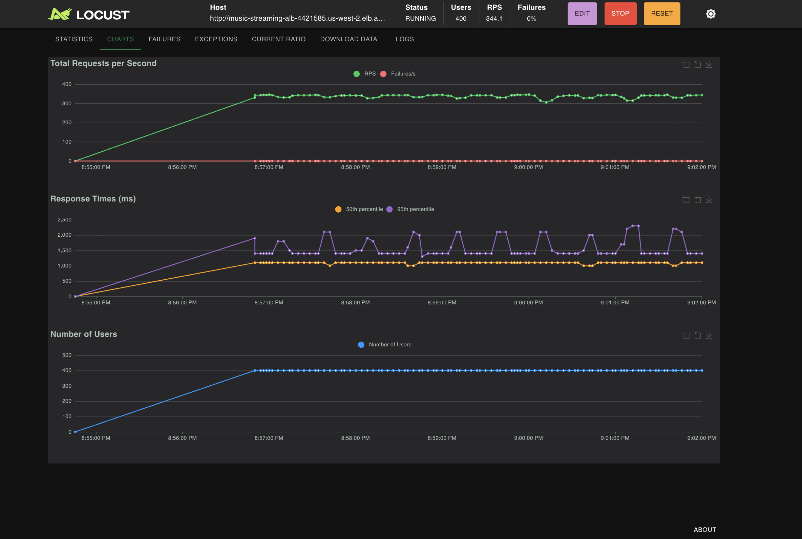

| Metric | Value |
|--------|-------|
| Median latency | 1,000 ms |
| p95 latency | 1,400 ms |
| p99 latency | 2,300 ms |
| RPS | 341.5 |
| Quality switches | 0 |
| Failures | 0% |

---

### Comparison

**Latency side-by-side (Adaptive vs Fixed):**

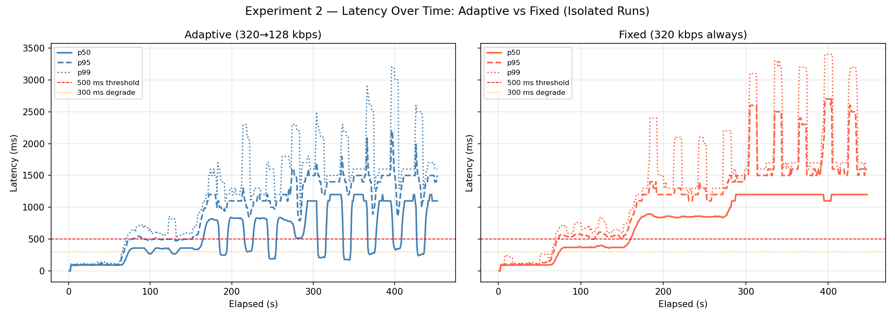

**Quality switches vs Rebuffers over time:**

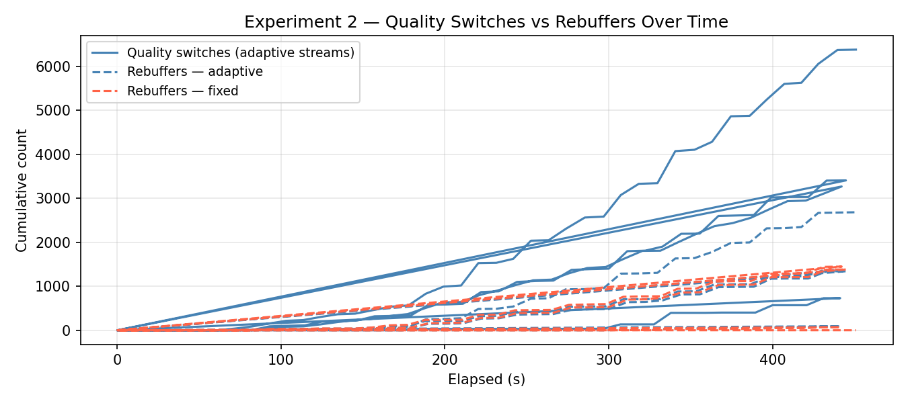

> The blue solid lines show cumulative quality switches (adaptive streams actively reducing CPU load). The dashed lines show rebuffer events, similar counts in both modes, but adaptive chunks arrive faster after each stall.

### Head-to-Head Comparison

| Metric | Adaptive-Only | Fixed-Only | Improvement |
|--------|---------------|------------|-------------|
| p50 latency | 680 ms | 1,000 ms | **32% faster** |
| p95 latency | 1,400 ms | 1,400 ms | same |
| p99 latency | 1,900 ms | 2,300 ms | **17% faster** |
| Throughput (RPS) | 567.1 | 341.5 | **+66% more** |
| Quality switches | 6,382 | 0 | — |
| Rebuffer events | 2,684 | 2,631 | ~similar |

### Key Findings

1. **Adaptive mode delivers 32% lower p50 latency and 66% more throughput** on the same 0.25 vCPU instance. The CPU savings from switching to 128kbps (10× less work per chunk) directly translate to more chunks served per second.
2. **Rebuffer event counts are similar across modes** (~670% per stream). This is expected: rebuffering is triggered by latency exceeding 300ms, and both modes spend time in that zone under saturation. The adaptive advantage is that chunks arrive *sooner after a stall* because the next chunk costs far less CPU.
3. **The CDN circuit breaker trips in every run**, confirming the system operates under genuine CPU pressure throughout there is no CDN shortcut inflating the adaptive results.

---

## 8. Experiment 3 — Horizontal Scaling

### Goal

Determine whether horizontal scaling produces near-linear capacity gains and whether it matters *which* tier you scale.

**Part A (complete):** Scale streaming instances (1 → 2 → 4), CDN fixed at 1. Predicts sub-linear gains because the single CDN becomes the bottleneck.

**Part B (complete):** Scale both tiers together (2+2 → 4+4). Tests whether co-scaling CDN keeps the circuit closed and produces near-linear gains.

All runs: **1,000 concurrent users**, fixed 320kbps, 7-minute runs on AWS ECS Fargate (0.25 vCPU per task).

---

### Part A — Scale Streaming Only (CDN Fixed at 1)

#### Summary

| Streaming Instances | p50 (ms) | p95 (ms) | p99 (ms) | RPS | CDN Circuit |
|--------------------|----------|----------|----------|-----|-------------|
| 1 | 2,700 | 4,600 | 7,400 | 339.2 | Open |
| 2 | 1,500 | 2,600 | 3,200 | 552.6 | Open |
| 4 | 580 | 1,100 | 1,400 | 1,186.7 | Open |

---

#### Run 1 — 1 Streaming Instance (Baseline)

**Statistics:**

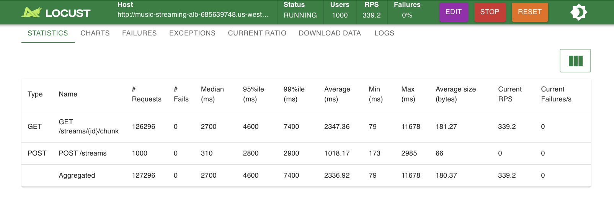

**Charts:**

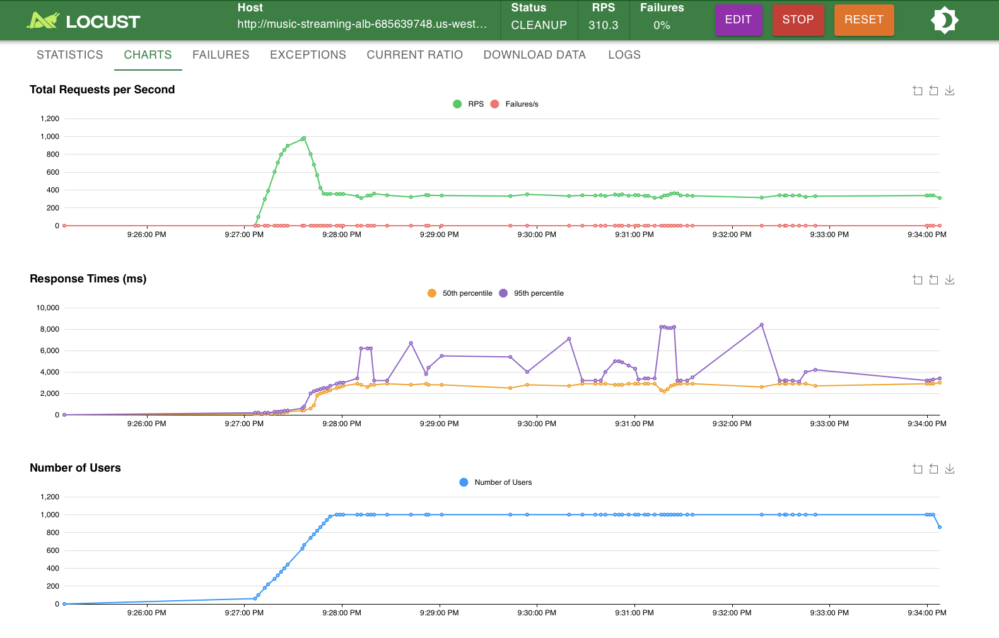

**Server metrics:**

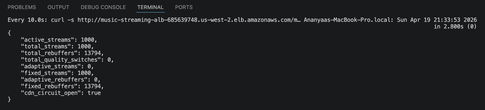

**What happened:**
- CDN circuit opened immediately under 1,000 users. All chunks fell back to local CPU generation (500k iterations/chunk).
- p50 spiked to 2,700ms, p99 to 7,400ms. RPS settled at 339 — same CPU ceiling as Experiment 1.
- Latency chart shows oscillating spikes: circuit trips (slow) → resets after 30s (fast) → trips again.

---

#### Run 2 — 2 Streaming Instances

**Statistics:**

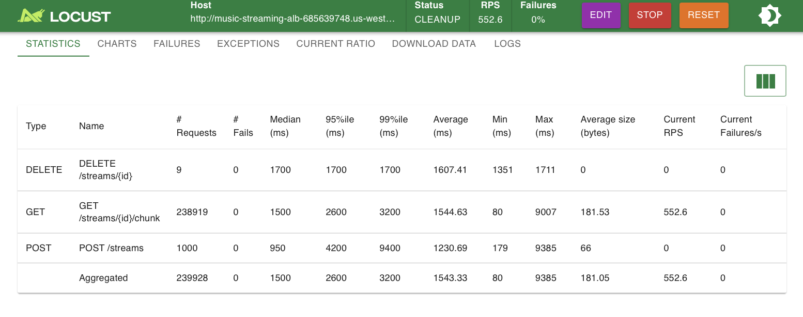

**Charts:**

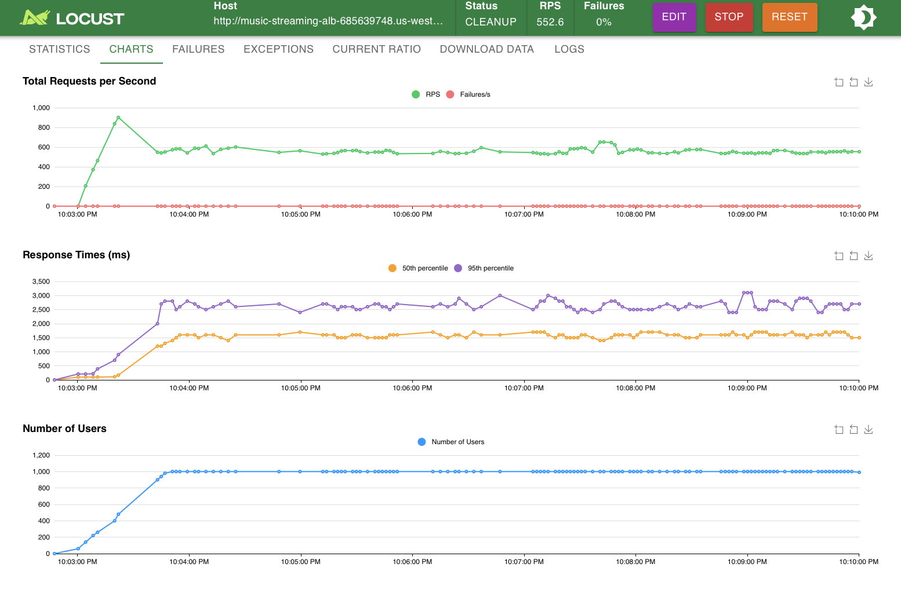

**Server metrics:**

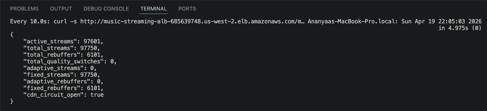

**What happened:**
- ALB sticky sessions (lb_cookie) required without them 33% of chunk requests returned 404 (stream state lives in-memory per instance).
- Each instance handled ~500 users. CDN circuit still opened in both, but fewer goroutines per instance means each local chunk generates faster.
- p50 dropped 44% (2,700 → 1,500ms), RPS up to 553. Chart is smoother less circuit breaker oscillation.

---

#### Run 3 — 4 Streaming Instances

**Statistics:**

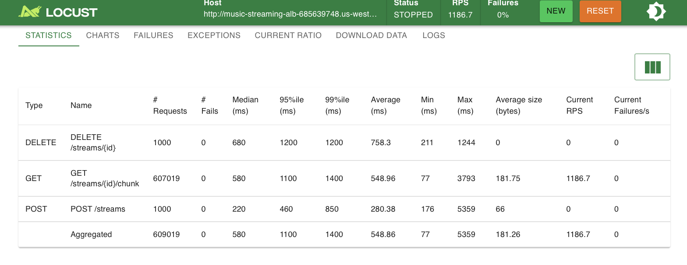

**Charts:**

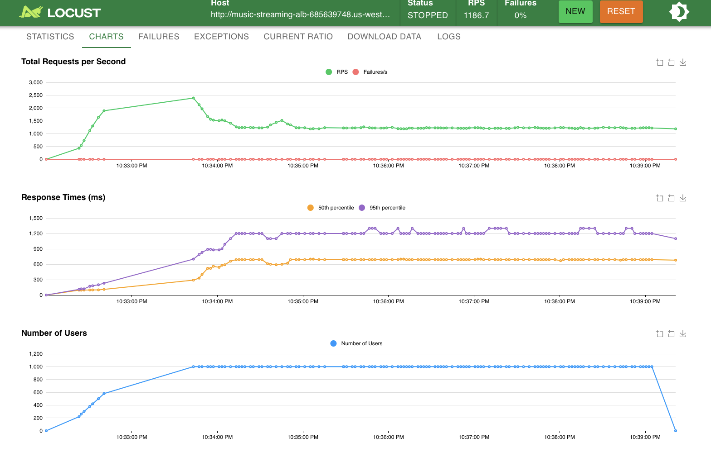

**Server metrics:**

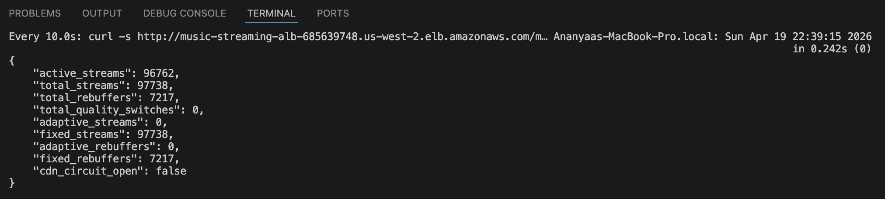

**What happened:**
- Each instance handled ~250 users. CDN circuit still opened (single CDN is always the bottleneck).
- p50 dropped to 580ms just above the 500ms rebuffer threshold. RPS nearly tripled vs Run 1 (339 → 1,187).
- Throughput scaling: 1× → 1.6× → 3.5× - near linear on RPS, sub-linear on latency.

---

#### Key Findings (Part A)

1. **CDN circuit opened in every run.** The single CDN is always the bottleneck — adding streaming instances multiplies CDN pressure without raising the CDN ceiling.
2. **Latency improvement comes from CPU scheduling, not CDN.** Fewer streams per instance (1000→500→250) means each goroutine gets more CPU time. This produces real but sub-linear latency gains.
3. **RPS scales near-linearly despite CDN failure.** Lower per-chunk latency means users cycle through chunks faster: 339 → 553 → 1,187 RPS (1× → 1.6× → 3.5×).

---

### Part B — Scale Both Tiers Together (CDN Scales with Streaming)

#### Summary

| Streaming | CDN | p50 (ms) | p95 (ms) | p99 (ms) | RPS | CDN Circuit |
|-----------|-----|----------|----------|----------|-----|-------------|
| 2 | 2 | 1,100 | 2,400 | 2,800 | 560.5 | Open |
| 4 | 4 | 380 | 1,100 | 1,400 | 1,191.8 | Open |

> Run 1+1 is identical to Part A Run 1 (CDN already at 1 instance).

---

#### Run 2 — 2+2

**Statistics:**

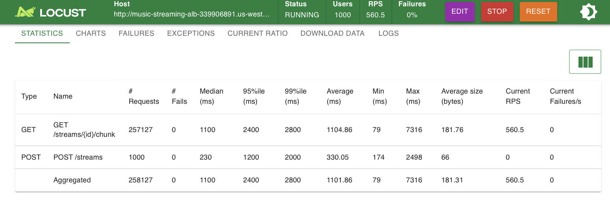

**Charts:**

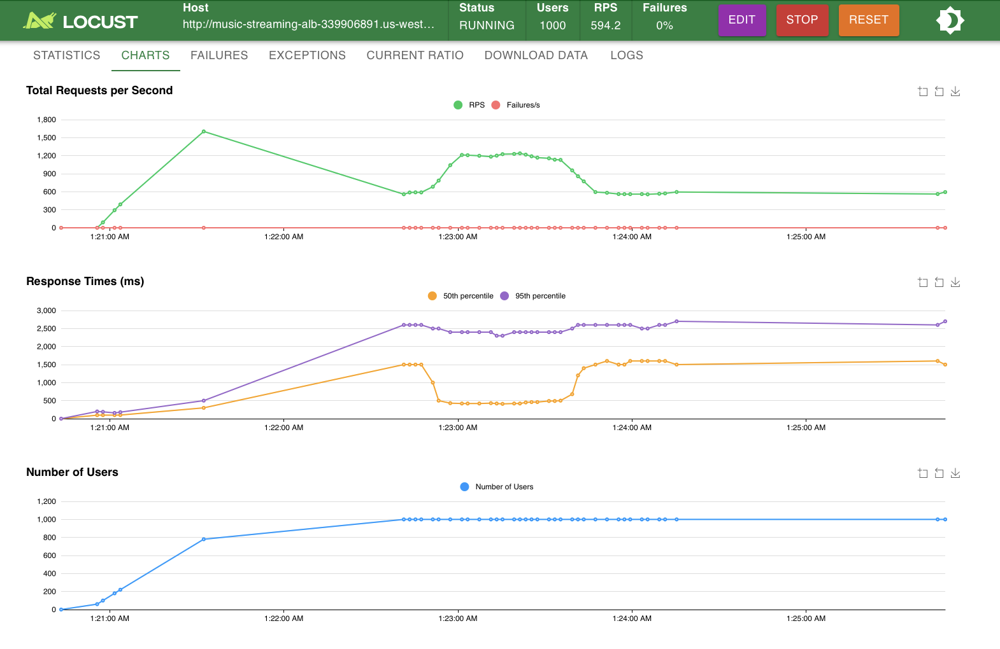

**Server metrics:**

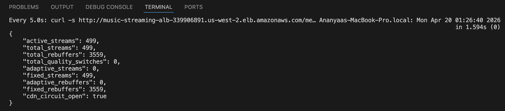

**What happened:**
- CDN circuit still opened despite 2 CDN instances. Chart shows oscillation: circuit trips, resets after 30s (dips to ~300ms), CDN briefly serves from cache, gets overwhelmed again.
- vs Part A 2+1: p50 improved 27% (1,500→1,100ms), p99 improved 13% (3,200→2,800ms), RPS unchanged.

---

#### Run 3 — 4+4

**Statistics:**

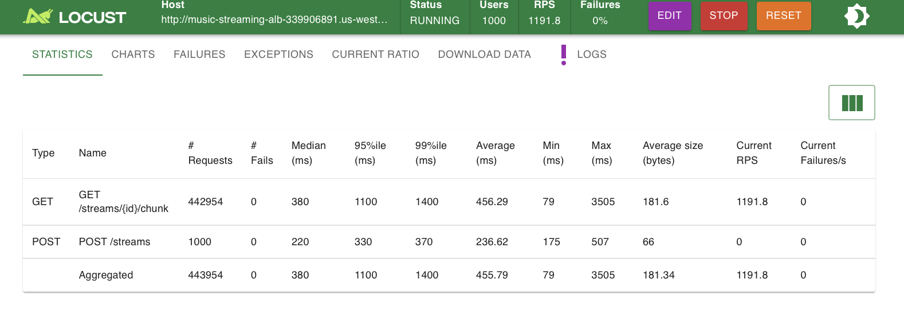

**Charts:**

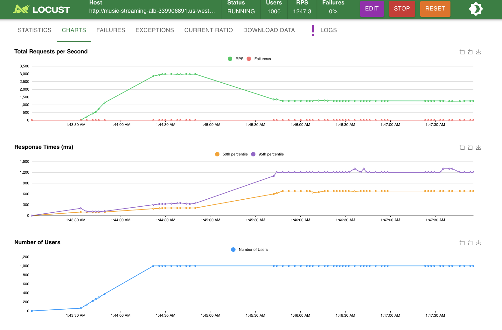

**Server metrics:**

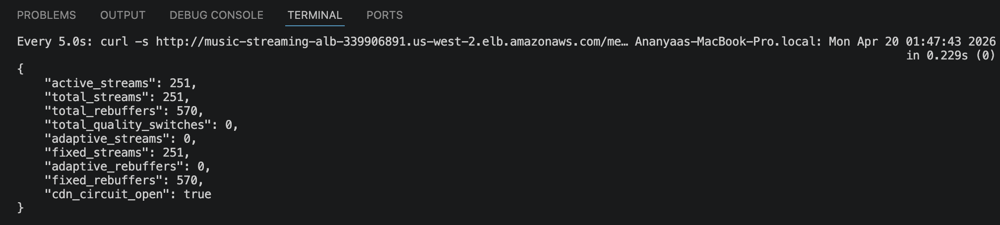

**What happened:**
- CDN circuit still opened, but chart is smooth — no oscillation. Circuit opens early and stays open.
- **p50 dropped below the 500ms rebuffer threshold** (380ms vs 580ms in Part A). First configuration where median chunk delivery is fast enough that most users do not rebuffer.
- Rebuffers dropped 68% vs Part A 4+1 (~2,280 vs ~7,217). p95/p99 and RPS unchanged — tail latency still driven by local generation.

---

#### Key Findings (Part B)

1. **CDN circuit still opened in all runs.** Symmetric scaling (N streaming + N CDN) does not keep the circuit closed — the aggregate CDN request rate still exceeds what N × 0.25 vCPU instances can sustain.
2. **Co-scaling CDN improves p50 and rebuffer count, not p95/p99.** At 4+4: p50 −35%, rebuffers −68% vs Part A. Tail latency is unchanged because it is driven by local generation on the streaming side.
3. **4+4 is the only configuration where p50 < 500ms** — the rebuffer threshold that matters for real listeners. It required scaling both tiers, not just streaming.

---

#### Extended Investigation — Diagnosing the CDN Bottleneck

We tested a 2:1 CDN ratio (4s+8c) and a higher circuit breaker threshold (CBFailureLimit 5→10). Both yielded identical results (p50≈510ms, circuit open), confirming the root cause is **CPU capacity per CDN task (0.25 vCPU), not instance count or threshold sensitivity.** The correct fix is larger CDN tasks (cdn_cpu=1024) rather than more small ones.

| Config | p50 | p95 | p99 | RPS | Circuit |
|--------|-----|-----|-----|-----|---------|
| 4s + 8c (threshold=5) | 520ms | 1100ms | 1400ms | 1232.9 | open |
| 4s + 8c (threshold=10) | 510ms | 1100ms | 1400ms | 1242.3 | open |

---

## 9. Local Development

### Run both services

```bash
# Terminal 1 - CDN cache (must start first)
cd cdn-cache-service
go run main.go

# Terminal 2 - Streaming service
cd streaming-service
CDN_URL=http://localhost:8081 go run main.go
```

### Health Check

```bash
curl -s -X POST http://localhost:8080/streams \
     -H 'Content-Type: application/json' \
     -d '{"song_id":"song_0","adaptive":false}' | python3 -m json.tool

curl -s http://localhost:8080/streams/<stream_id>/chunk | python3 -m json.tool
curl -s http://localhost:8080/metrics | python3 -m json.tool
```

---

## 10. AWS Deployment

```bash
# Deploy everything (builds + pushes Docker images, then deploys ECS)
cd terraform
terraform init
terraform apply

# Get ALB endpoint
terraform output alb_dns_name

# Run Experiment 1
cd ../locust
locust -f locustfile.py StreamUser --host http://<ALB_DNS> -u 500 -r 10 -t 5m

# Watch server-side metrics while test runs (second terminal)
watch -n 5 "curl -s http://<ALB_DNS>/metrics | python3 -m json.tool"

# Teardown
cd ../terraform && terraform destroy
```

---

## Authors
Ananyaa Mylsamy · Manasha Sekar
